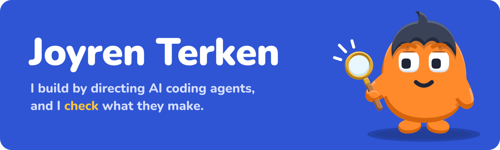
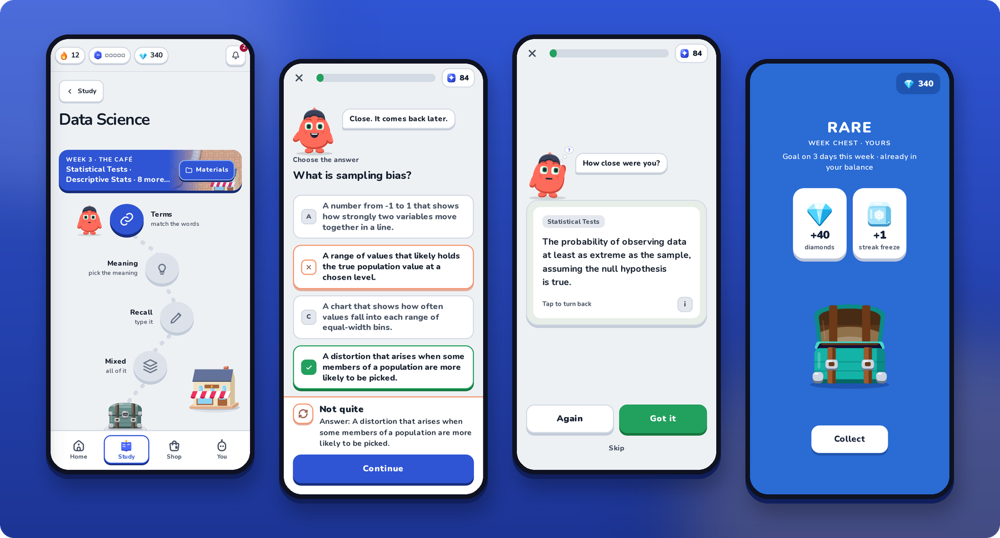
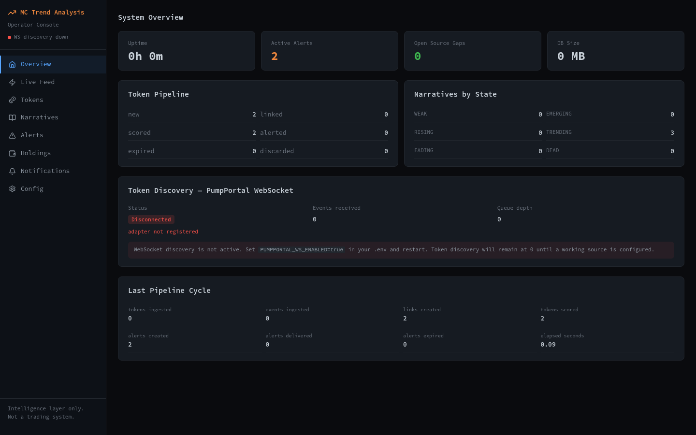
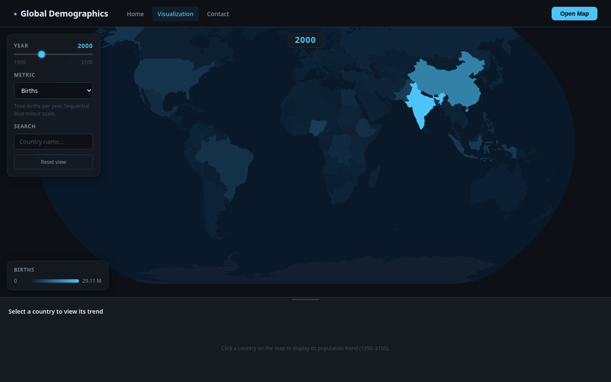
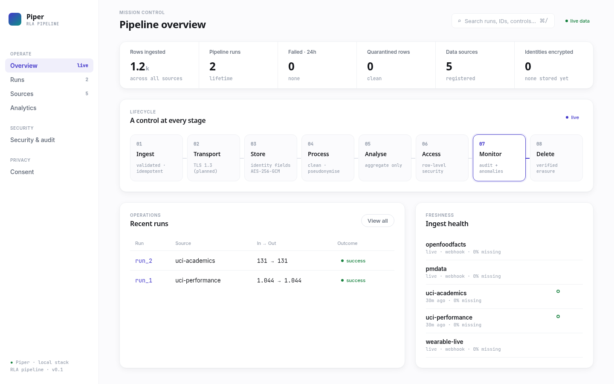
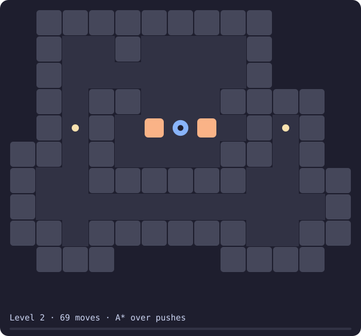

<picture>
  <source media="(prefers-color-scheme: dark)" srcset="assets/banner-dark.svg">
  
</picture>

I'm building **[StudySync](https://studysync.nl)**: it reads your course in Moodle or Canvas and turns
it into flashcards, quizzes and cheatsheets, week by week. It is pre-launch.

I specialize in agent pipelines and orchestration: getting AI coding agents to build, review and ship real software, and knowing when their output can be trusted.

Almost everything here was built by directing AI coding agents, mostly [Claude Code](https://claude.com/claude-code).
I don't hand-write most of the code anymore. My part is the direction and the checking:

- **Orchestration:** splitting work across parallel agents in separate worktrees, with one job per agent and a clear brief for each.
- **Review pipelines:** multi-agent audits and critique rounds , where separate agents verify findings before anything is changed.
- **Guardrails:** project rules, skills and memory files that agents read before they work, plus tests that fail when a rule is broken, such as an untrue marketing claim or a leaked answer key.
- **Long-running jobs:** render and build pipelines on rented GPUs that resume after a failure, shut themselves down and log their cost.
- **Verification:** type checks, tests and my own eyes on the result before it ships.

Every README says what was run and what was not, so you can tell what is verified from what is only built.

<p>
  <a href="https://studysync.nl"><b>studysync.nl</b></a> ·
  <a href="https://www.linkedin.com/in/joyren-terken-0bb02429a">LinkedIn</a> ·
  <a href="https://www.instagram.com/dev.joyren">@dev.joyren</a> ·
  <a href="https://www.instagram.com/studysyncnl">@studysyncnl</a>
</p>

<picture>
  <source media="(prefers-color-scheme: dark)" srcset="assets/stats-dark.svg">
  
</picture>

## StudySync

<a href="https://github.com/DevCrazyCube/studysync-showcase">
  <picture>
    <source media="(prefers-color-scheme: dark)" srcset="assets/studysync-dark.png">
    
  </picture>
</a>

The product I'm building. A student connects Moodle or Canvas once, and every week of the course
becomes a short path of practice: flashcards with spaced repetition, a quiz, a cheatsheet, and a
class quiz on the big screen. Pre-launch, so no customers yet. The source is private; the
**[explainer with screenshots of the current app](https://github.com/DevCrazyCube/studysync-showcase)** is public.

## Claude skills

Seven small skills for Claude Code. Each is one folder: the instructions, a script for the part a
machine can check, and tests for that script.

```bash
# install one: clone it into your skills folder
git clone https://github.com/DevCrazyCube/claude-skill-cold-read ~/.claude/skills/cold-read
```

| Skill | Use it when | Checked by |
| --- | --- | --- |
| **[cold-read](https://github.com/DevCrazyCube/claude-skill-cold-read)** | You wrote a README, pitch or brief and can no longer read it as a stranger. A fresh agent gets only what the audience gets and says what it understood | Two example reads in the repo |
| **[evidence-first-research](https://github.com/DevCrazyCube/claude-skill-evidence-first-research)** | A research log must not turn guesses into findings. Every claim carries a label: measured, sourced or assumed | A linter, 28 tests |
| **[agent-progress-log](https://github.com/DevCrazyCube/claude-skill-agent-progress-log)** | Several agents and people work in one repo and the progress file keeps getting overwritten. One fragment per piece of work, one generated log | 9 tests |
| **[film-ear-eye](https://github.com/DevCrazyCube/claude-skill-film-ear-eye)** | A film is "done" and nobody measured it. Loudness and silences; cuts, camera speed and holds | A self-test on a generated film, 17 checks |
| **[art-director-round](https://github.com/DevCrazyCube/claude-skill-art-director-round)** | The numbers pass and it still looks unfinished. A separate critic judges stills of every shot, full size and phone width | 11 tests, one example round |
| **[short-reel-method](https://github.com/DevCrazyCube/claude-skill-short-reel-method)** | A short comedy reel needs a point. One truth, one turn, and a one-line pitch that is checked before anything is drawn | 25 tests |
| **[comfyui-job-pipeline](https://github.com/DevCrazyCube/claude-skill-comfyui-job-pipeline)** | A frontend talks to ComfyUI node ids directly. This puts ComfyUI behind one boundary | 51 tests against a mock server, not against ComfyUI |

## Projects

<table>
  <tr>
    <td width="50%">
      <a href="https://github.com/DevCrazyCube/mc-trend-analysis"></a>
      <br><b><a href="https://github.com/DevCrazyCube/mc-trend-analysis">mc-trend-analysis</a></b><br>
      Links new token launches to news and search narratives and scores potential against risk.
      It does not trade. The picture shows the key-free demo on made-up data.
    </td>
    <td width="50%">
      <a href="https://github.com/DevCrazyCube/VitalMap"></a>
      <br><b><a href="https://github.com/DevCrazyCube/VitalMap">VitalMap</a></b><br>
      World births and deaths, 1950 to 2100, on an interactive D3 map. Flask, D3, GSAP.
    </td>
  </tr>
  <tr>
    <td width="50%">
      <a href="https://github.com/DevCrazyCube/piper"></a>
      <br><b><a href="https://github.com/DevCrazyCube/piper">piper</a></b><br>
      A data pipeline with encryption and audit built in. A four-person school project; the
      security pillar is my part. The picture shows two public test datasets.
    </td>
    <td width="50%">
      <a href="https://github.com/DevCrazyCube/dynamic-sokoban-pathfinding"></a>
      <br><b><a href="https://github.com/DevCrazyCube/dynamic-sokoban-pathfinding">dynamic-sokoban-pathfinding</a></b><br>
      A Sokoban solver in pure Python: BFS over moves, A* over pushes. The animation is the
      solver's own SVG export.
    </td>
  </tr>
</table>

| Also | What it is |
| --- | --- |
| [trading-research-lab](https://github.com/DevCrazyCube/trading-research-lab) | Evidence-first trading research: a measurement harness and forward paper tests. Not a trading bot, and nothing in it is shown to make money after costs |
| [Flappybird-Reinforcement-learning](https://github.com/DevCrazyCube/Flappybird-Reinforcement-learning) | A PPO agent that learned Flappy Bird from five numbers. The game underneath is someone else's and is credited there |
